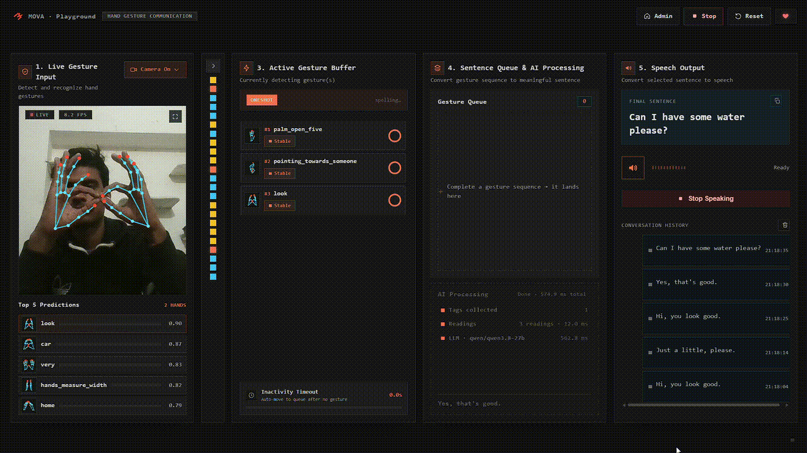
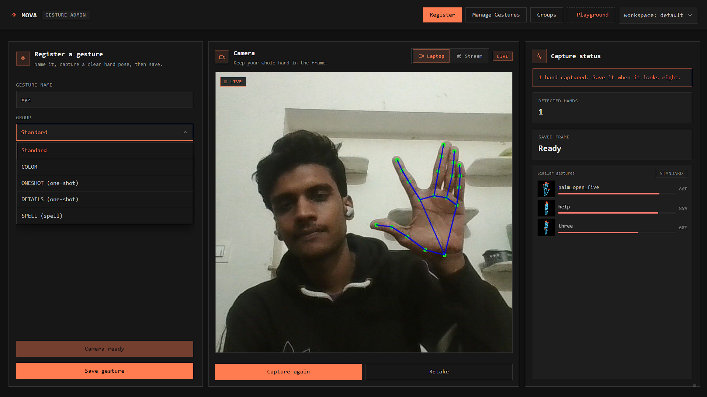
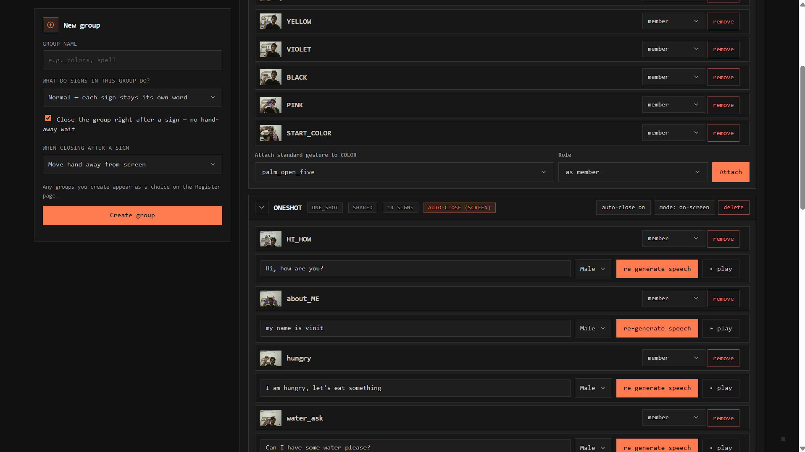
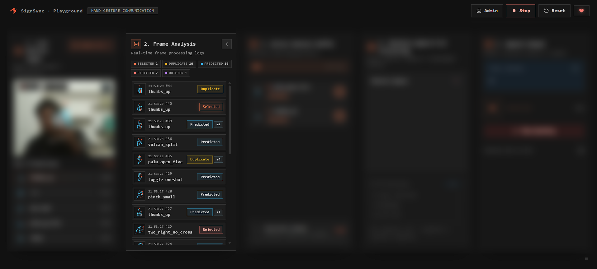

# SignSync

### Real-Time Hand Gesture Recognition & Speech

<p align="center">
  
</p>

SignSync is a computer-vision system that turns live hand gestures into
recognized actions and spoken responses. A camera feeds frames to a backend,
MediaPipe extracts hand landmarks, a fusion scorer compares the pose against a
stored gesture library, and a buffer + speech layer turns accepted gestures
into audio.

***

## Highlights

- **Real-time hand tracking** with MediaPipe: 21 landmarks per hand, Left/Right.
- **Fusion scoring**: shape similarity + finger extension + inter-finger gaps
  combined into a single 0–100% match score.
- **Group-scoped matching** so gestures in different groups never collide.
- **Live Playground**: landmark overlay, top-5 match preview, buffer state,
  sentence layer, and TTS playback.
- **Register page**: name-gated capture with a 3-2-1 countdown and a live
  "similar gestures" panel to prevent duplicates.
- **Groups management**: create, rename, and organize gesture collections.

***

## Screenshots

### Playground: live gesture input


The Playground is the live demo surface. It shows the camera feed with a
hand-skeleton overlay, the top-5 matching gestures with skeleton thumbnails and
similarity percentages, the gesture buffer state, the AI sentence layer, and
text-to-speech playback: all updating in real time.

***

### Register: capture & save a gesture



The Register page lets you author new gestures. The camera opens by default
with a live landmark overlay; a 3-2-1 countdown captures the pose, and the
frame is shown for review before saving. Saving stays blocked until a gesture
name is entered, and a "similar gestures" panel warns about duplicates inside
the selected group.

***

### Groups: organize gesture collections



Groups keep gestures scoped. Inside a group, only that group's gestures are
matched against, so a group is free to reuse a standard pose without
triggering a duplicate warning.

***

## How it works

1. **Capture**: camera (webcam or stream) produces JPEG frames.
2. **Detection (MediaPipe)**: hand landmarks + handedness extracted server-side.
3. **Feature extraction**: landmarks become a numeric pose vector
   (71 dims for one hand, 145 dims for two hands).
4. **Fusion scoring**: the live pose is scored against stored gestures using
   cosine shape similarity, finger-extension profile, and inter-finger tip gaps.
5. **Scoping**: only gestures in the active group compete.
6. **Threshold**: a match must clear ~65% confidence.
7. **Buffer**: accepted gestures are sequenced; emits completion events.
8. **Speech (TTS)**: composes and speaks a sentence from the gesture sequence.


***

## Post-processing: per-frame pipeline



Every frame passes through a cleanup stage before a gesture is accepted:
outliers are dropped, frames below the confidence threshold are ignored,
and only stable, above-threshold poses make it into the gesture buffer.


***

## Quickstart

```bash
# 1. Activate virtual environment
source venv/bin/activate

# 2. Install dependencies
pip install -r requirements.txt

# 3. Launch
python run_server.py
# Open http://localhost:8000
```

***

## Project structure

```
SignSync/
├── src/          # server, pipeline, vision, buffer, spaces, storage
├── templates/    # frontend pages (playground, register, groups, gestures)
├── static/       # css + js
├── data/         # JSON gesture/space/workspaces stores
├── assets/       # screenshots, gif, 3d models
├── docs/         # architecture & pipelines
└── hardware/     # embedded firmware (optional)
```

***

## Documentation

- [Architecture](docs/ARCHITECTURE.md)
- [Camera Pipeline](docs/004-camera-pipeline-vision-models.md)
- [Spell Mode](docs/005-spell-mode.md)
```
